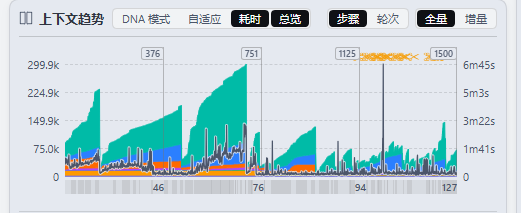
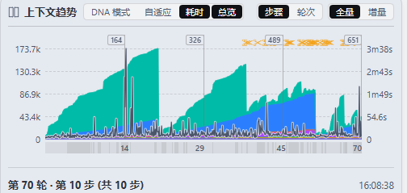

# DSH 工具结果代谢

我用 DeepSeek Harness（DSH）做长任务时，工具经常吐出几千行日志、搜索结果和文件内容。当轮看完就够了，可到了下一轮，模型还是要带着这些旧输出继续跑。于是我给工具结果做了个「代谢」策略。

每轮结束后，插件会检查仍在上下文里的本轮及历轮工具结果。正常结束、报错或中止都会触发检查。未标注且换成占位符后能节省 token 的结果，会缩成一条带原事件号的短消息。模型可以从原始日志按编号回读。跨轮还要用的原文可以提前标注。

我自己用下来，没感觉模型能力有明显下降，跑长任务反而有种很丝滑的感觉。也许是因为上下文轻薄了。这是我的实际使用感受，效果会随任务、工具输出和模型而变。

## 我实际用下来的前后变化

我用「上下文洞察」截了两个不同 Agent 的上下文趋势。**每张图都从左往右读。前半段还没启用代谢插件，后半段已经启用。** 我主要看青绿色的工具结果区。启用前，它常常在一段任务里越积越高。启用后，当轮依然会产生长工具输出，后续请求里更常看到青绿色区域回落。

**Agent A 的上下文趋势**



**Agent B 的上下文趋势**



两张图的纵轴各自缩放，我会在同一张图里对照启用前后的走势。要算具体省了多少，可以按下文的步骤比较请求里的 token 估算。

## 安装

插件通过本地文件加载，运行时代码只有 [`metabolism-host.mjs`](metabolism-host.mjs)。我在 Windows 桌面版 DSH `0.2.1-rc.1` 的 Web 宿主上使用，其他宿主和版本请先用测试会话验证。

1. 从 [GitHub Releases](https://github.com/lkjhoiuyfdsaw-maker/dsh-context-metabolism/releases) 下载 ZIP 安装包，解压到固定目录。也可以克隆仓库。[更新说明](CHANGELOG.md)
2. 备份 Web profile 的 `cordis.patch.yml`。默认 Web profile 的文件位于 `~/.dsh/profiles/web/cordis.patch.yml`。将下面的条目追加到现有 YAML 顶层列表，并把 URL 换成实际文件的位置。已有代谢插件条目时，更新原来的条目即可。

   ```yaml
   - insert:
       - id: context-metabolism-local
         name: 'file:///C:/dsh-plugins/dsh-context-metabolism/metabolism-host.mjs'
   ```

3. 重启 DSH Web 宿主。新开一个会话，确认模型可用工具中出现 `context_metabolism`。让工具返回较长的测试输出，等本轮结束后，在会话的工具结果记录中核对 `［工具结果已代谢，原事件 …］` 占位符。无需再发一轮消息。

需要停用时，移除自己追加的注册条目并重新加载宿主。占位符和原事件会留在已有会话记录里。

## 我推荐搭配「上下文洞察」使用

在 DSH 的插件页面找「上下文」或 `dsh-context`，启用后用 `/context` 或界面里的上下文浏览器打开同一个会话。代谢可以独立运行，洞察插件帮我看清楚每次请求到底带了多少内容。

1. 在测试会话让工具返回一段长输出，完成这一轮。记下本轮末步「工具结果」和总上下文的 token 估算。
2. 不增加长输入，发一句短消息开启下一轮。在趋势图选中下一轮第 1 步，再看「工具结果」的 token 估算。
3. 展开工具结果列表，核对长输出是否变成带事件号的短占位符。占位符也计入结果条数，所以我主要看 token 差值。想测得更稳，可以用同样的输入和工具输出跑一组未启用代谢的对照。

一次本机记录里，工具结果从约 **18,903** 降到 **12,267 tokens**，相邻请求相差 **6,636 tokens（约 35%）**。这是上下文洞察对请求内容的估算，适合观察单次会话的变化。账单和缓存命中请以模型服务方的记录为准。

## 跨轮保留与回读

| 操作 | 用途 |
| --- | --- |
| `list` | 查看仍在上下文中的候选结果及标注 |
| `mark` | 用 `keep: [{ seq, reason }]` 保留关键原文，标注跨轮有效 |
| `release` | 用 `seqs` 取消标注，本轮结束后重新参与代谢 |
| `read` | 查当前会话原始工具记录，支持筛选和批量回读 |
| `remember`、`notes`、`forget` | 维护当前会话里可复用的短笔记 |

`read` 不填 `ref` 时列当前轮之前最近三轮的工具输入及编号。`T4` 查第 4 轮，`T4S2` 查第 2 步，`T4S2-files_entry` 精确筛选工具名。加 `-output` 读输出，加 `-both` 同时读输入和输出。

用 `ref: "T4S2:123"` 回读原始事件，原日志保留期间编号在代谢及回放后仍可用。读取结果时同时返回对应输入。`ref` 可以传 1 至 8 项数组，也可继续用数字 `seq` 读取文字。有 `nextOffset` 时，单独提交结果编号及对应的 `offset` 续读。

我通常会保留后续还要核对的证据、未完成任务的回执，以及必须逐字引用的内容。代谢管理回执和替换后省不了 token 的短结果默认保留。代谢修改的是发给模型的上下文，原始事件仍留在会话日志里。

## 测试

用 Node.js 运行 `node --test metabolism-host.test.mjs metabolism-marking.test.mjs` 可执行全部测试。`metabolism-host.test.mjs` 覆盖当前插件，需有兼容的 DSH 安装。Windows 桌面版默认从本机安装目录加载 DSH 模块，自定义安装可将 `DSH_PACKAGES_DIR` 指向 DSH 的 `node_modules/@deepseek-ai` 目录。`node --test metabolism-marking.test.mjs` 可独立运行，覆盖早期的标注策略原型。

采用 [MIT 许可证](LICENSE)。
